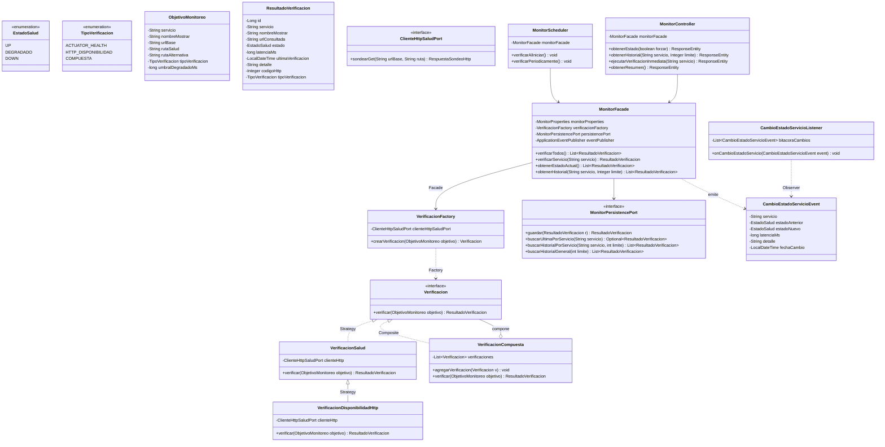

# Microservicio Monitor de Salud (`monitor-service`)

**Proyecto Universitario UADE - Desarrollo de Aplicaciones II**

Microservicio responsable del monitoreo continuo de salud (*Health Check*), medición de latencia en milisegundos, detección de degradación/caídas y registro de historial de disponibilidad de todos los microservicios del ecosistema **DDA Motors** (`vehiculos`, `clientes`, `leads` y `calificacion`).

Implementado siguiendo los principios de **Arquitectura Hexagonal (Ports & Adapters)** y cumpliendo el contrato definido en `docs/contratos-backend.md`.

---

## Stack Tecnológico
- **Java 21**
- **Spring Boot 3.3.4**
  - Spring Web (MVC & RestClient)
  - Spring Boot Actuator
  - Spring Data JPA
  - Spring Validation
  - SpringDoc OpenAPI 2.6.0 (Swagger UI)
- **H2 Database** (en memoria por defecto para ejecución inmediata sin dependencias externas; compatible con PostgreSQL por variables de entorno)
- **Lombok**
- **JUnit 5 / AssertJ / Mockito**

---

## Arquitectura Hexagonal

```
com.uade.crm.monitor
├── domain/                      <- Núcleo del Dominio (Sin acoplamiento de infraestructura)
│   ├── model/                  <- Entidades y Objetos de Valor (EstadoSalud, ResultadoVerificacion, ObjetivoMonitoreo)
│   ├── verificacion/           <- Patrones Strategy, Composite y Factory para sondeos de salud
│   ├── event/                  <- Eventos de dominio (CambioEstadoServicioEvent)
│   └── port/                   <- Puertos de salida (ClienteHttpSaludPort, MonitorPersistencePort)
│
├── application/                <- Capa de Aplicación / Orquestación
│   ├── facade/                 <- MonitorFacade (coordinador de verificaciones y consultas)
│   ├── scheduler/              <- MonitorScheduler (sondeo periódico automático @Scheduled)
│   └── listener/               <- CambioEstadoServicioListener (Patrón Observer para alertas de caída/recuperación)
│
├── infrastructure/             <- Adaptadores de Infraestructura
│   ├── client/                 <- RestClientSaludAdapter (medición de latencia en ms y manejo de timeouts)
│   └── persistence/            <- JPA, Repositorio e Historial de Verificaciones
│
├── api/                        <- Adaptadores Primarios / Entrada REST
│   ├── controller/             <- MonitorController (/monitor/estado, /monitor/historial, /monitor/verificar, /monitor/resumen)
│   ├── dto/                    <- DTOs de respuesta según contrato del frontend
│   └── advice/                 <- Manejo global de excepciones (RFC 7807 ProblemDetail)
│
└── config/                     <- Configuración de propiedades, CORS, RestClient y OpenAPI
```

---

## Patrones de Diseño Implementados

El microservicio implementa **6 patrones de diseño orientados a objetos**, incluyendo los 3 recomendados específicamente para `monitor` en `docs/contratos-backend.md` (`Strategy`, `Observer` y `Composite`):

| Patrón | Dónde se aplica | Justificación técnica |
|---|---|---|
| **Strategy** | `Verificacion`, `VerificacionSalud`, `VerificacionDisponibilidadHttp` | Permite intercambiar la forma en que se comprueba cada servicio (Actuator `/actuator/health`, disponibilidad HTTP/OpenAPI, etc.) sin modificar el planificador ni la fachada, respetando el principio *Open/Closed* (OCP). |
| **Composite** | `VerificacionCompuesta` | Permite tratar un conjunto de chequeos como si fuera una sola `Verificacion`, consolidando la latencia total y reportando inmediatamente el primer eslabón que falla (`DOWN`) o se degrada (`DEGRADADO`). |
| **Observer** | `CambioEstadoServicioEvent` y `CambioEstadoServicioListener` | Desacopla la detección de cambios de estado (`UP -> DOWN`, `DOWN -> UP`, `UP -> DEGRADADO`). Cuando un servicio cambia de estado, los observadores registran alertas en log y actualizan la bitácora sin que el verificador los conozca. |
| **Factory** | `VerificacionFactory` | Centraliza la creación y parametrización de la estrategia de verificación (`ACTUATOR_HEALTH`, `HTTP_DISPONIBILIDAD`, `COMPUESTA`) según la configuración de cada microservicio objetivo. |
| **Facade** | `MonitorFacade` | Expone operaciones simples al controlador y al planificador (`verificarTodos`, `verificarServicio`, `obtenerEstadoActual`, `obtenerHistorial`), ocultando la coordinación entre la fábrica de estrategias, la persistencia JPA y la emisión de eventos. |
| **Repository** | `MonitorPersistencePort`, `MonitorPersistenceAdapter`, `VerificacionRepository` | Aísla la capa de dominio puro del mapeo relacional JPA/Hibernate (`VerificacionEntity`). |

### Diagrama de Clases UML



---

## Reglas de Evaluación de Salud

Para cada microservicio monitoreado, el servicio evalúa:

1. **Ruta Primaria y Ruta Alternativa (Fallback):**
   - Consulta inicialmente la ruta primaria de salud (`/actuator/health` o `/health`).
   - Si el servicio está activo pero no tiene Actuator habilitado (devuelve `404`), consulta automáticamente la ruta alternativa configurada (`/v3/api-docs` en Spring Boot o `/openapi.json` en FastAPI).
2. **Determinación de `EstadoSalud`:**
   - 🟢 **`UP`**: Responde con código HTTP `2xx`, el cuerpo no reporta `"status": "DOWN"`, y la latencia es menor al umbral configurado (`1000 ms` por defecto).
   - 🟡 **`DEGRADADO`**: Responde con código HTTP `2xx` pero con una latencia mayor o igual al umbral (`>= 1000 ms`), o devuelve un código `4xx`.
   - 🔴 **`DOWN`**: Error de red/conexión (*Connection refused*, *Timeout*), código HTTP `5xx`, o el JSON de Actuator reporta `"status": "DOWN"` / `"OUT_OF_SERVICE"`.

---

## Endpoints REST (Puerto 8085)

| Método | Endpoint | Descripción |
|---|---|---|
| `GET` | `/monitor/estado` | Devuelve la lista de microservicios con su estado vigente (`UP`, `DEGRADADO`, `DOWN`), latencia en ms, fecha de última verificación y detalle. Acepta `?forzar=true` para ejecutar un sondeo en vivo antes de responder. |
| `GET` | `/monitor/historial` | Devuelve las últimas verificaciones registradas en orden cronológico inverso. Acepta `?servicio=vehiculos` (opcional) y `?limite=50` (opcional). |
| `POST` | `/monitor/verificar` | Fuerza una verificación inmediata en paralelo de todos los servicios (o de uno específico con `?servicio=calificacion`) y devuelve el resultado. |
| `POST` | `/monitor/despertar` | Envía pings en paralelo con timeout extendido y reintentos automáticos a todos los servicios (o a uno específico con `?servicio=clientes`) para despertar contenedores inactivos/hibernados (cold start en Render) y devuelve el estado resultante. |
| `GET` | `/monitor/resumen` | Devuelve métricas agregadas del ecosistema (`estadoGlobal`, total de servicios `UP`/`DEGRADADO`/`DOWN` y latencia promedio). |
| `GET` | `/actuator/health` | Endpoint de salud propio del microservicio Monitor. |
| `GET` | `/swagger-ui.html` | Interfaz interactiva Swagger UI. |
| `GET` | `/v3/api-docs` | Especificación OpenAPI 3.0. |

### Ejemplo de Respuesta: `GET /monitor/estado`

```json
[
  {
    "id": 1,
    "servicio": "vehiculos",
    "nombreMostrar": "Microservicio de Vehículos",
    "estado": "UP",
    "latenciaMs": 38,
    "ultimaVerificacion": "2026-11-08T20:45:00.125",
    "detalle": "Operativo (HTTP 200 en 38 ms)",
    "urlConsultada": "http://localhost:8083/actuator/health",
    "codigoHttp": 200,
    "tipoVerificacion": "ACTUATOR_HEALTH"
  },
  {
    "id": 2,
    "servicio": "clientes",
    "nombreMostrar": "Microservicio de Clientes",
    "estado": "UP",
    "latenciaMs": 42,
    "ultimaVerificacion": "2026-11-08T20:45:00.170",
    "detalle": "Operativo (HTTP 200 en 42 ms)",
    "urlConsultada": "http://localhost:8082/actuator/health",
    "codigoHttp": 200,
    "tipoVerificacion": "ACTUATOR_HEALTH"
  },
  {
    "id": 3,
    "servicio": "leads",
    "nombreMostrar": "Microservicio de Leads",
    "estado": "DOWN",
    "latenciaMs": 12,
    "ultimaVerificacion": "2026-11-08T20:45:00.185",
    "detalle": "Sin conexión: Connection refused",
    "urlConsultada": "http://localhost:8000/health",
    "codigoHttp": null,
    "tipoVerificacion": "ACTUATOR_HEALTH"
  },
  {
    "id": 4,
    "servicio": "calificacion",
    "nombreMostrar": "Microservicio de Calificación",
    "estado": "UP",
    "latenciaMs": 29,
    "ultimaVerificacion": "2026-11-08T20:45:00.215",
    "detalle": "Operativo (HTTP 200 en 29 ms)",
    "urlConsultada": "http://localhost:8084/v3/api-docs",
    "codigoHttp": 200,
    "tipoVerificacion": "ACTUATOR_HEALTH"
  }
]
```

---

## Servicios Monitoreados y Variables de Entorno

Configurables en `src/main/resources/application.yml` o mediante variables de entorno:

| Servicio | Variable de Entorno | URL por defecto | Ruta Primaria | Ruta Alternativa |
|---|---|---|---|---|
| `vehiculos` | `VEHICULOS_SERVICE_URL` | `http://localhost:8083` | `/actuator/health` | `/v3/api-docs` |
| `clientes` | `CLIENTES_SERVICE_URL` | `http://localhost:8082` | `/actuator/health` | `/v3/api-docs` |
| `leads` | `LEADS_SERVICE_URL` | `http://localhost:8000` | `/health` | `/openapi.json` |
| `calificacion` | `CALIFICACION_SERVICE_URL` | `http://localhost:8084` | `/actuator/health` | `/v3/api-docs` |

Otras variables de configuración:
- `PORT`: Puerto del servidor (por defecto `8085`).
- `MONITOR_INTERVALO_MS`: Intervalo del planificador automático en milisegundos (por defecto `15000`).
- `MONITOR_TIMEOUT_MS`: Timeout de conexión y lectura HTTP por servicio (por defecto `3000`).
- `MONITOR_UMBRAL_DEGRADADO_MS`: Umbral de latencia a partir del cual un servicio `200 OK` se considera `DEGRADADO` (por defecto `1000`).
- `CORS_ALLOWED_ORIGINS`: Orígenes permitidos para el Frontend (por defecto `http://localhost:5173,http://localhost:3000`).

---

## Pruebas Unitarias y Ejecución

Para ejecutar la suite de pruebas unitarias (verifica los patrones **Strategy**, **Composite**, **Factory**, **Facade** y **Observer**):

```bash
mvn test
```

Para iniciar el microservicio localmente en el puerto `8085`:

```bash
mvn spring-boot:run
```
